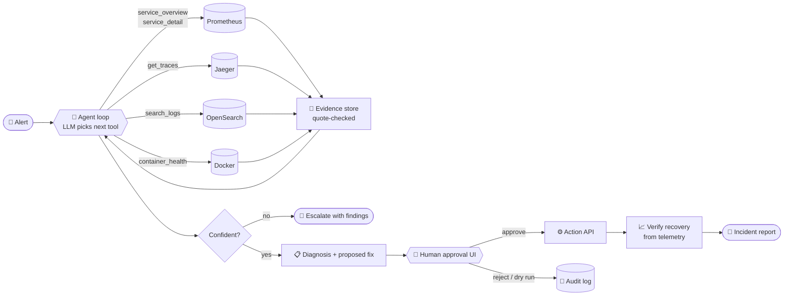

<div align="center">

# 🚨 Incident Zero

### An AI on-call engineer that finds the root cause, proves it, and fixes it only with your approval.

<p>
  
  
  
  
  
  
  
</p>

<p>
  <a href="#-quick-start">Quick start</a> •
  <a href="#-how-it-works">How it works</a> •
  <a href="#%EF%B8%8F-safety-model">Safety</a> •
  <a href="#-usage">Usage</a> •
  <a href="#-configuration">Configuration</a> •
  <a href="#-known-limitations">Limitations</a>
</p>

</div>

---

When production breaks, the first hour of on-call goes on searching: reading logs, checking dashboards, digging through traces, guessing. **Incident Zero does that hour for you.** It takes an alert, picks its own tools to investigate the [OpenTelemetry Astronomy Shop](https://github.com/open-telemetry/opentelemetry-demo), and names the failing component. Every claim cites evidence it can check. It then proposes a fix from an allowlisted runbook, waits for a human to approve it, applies it, and checks that the system actually recovered.

> **A good agent is not the one that always acts.** It acts when it has evidence, and when it doesn't, it says *"I'm not sure, here is what I found."*

## 📑 Table of contents

- [Features](#-features)
- [How it works](#-how-it-works)
- [Safety model](#%EF%B8%8F-safety-model)
- [Quick start](#-quick-start)
- [Usage](#-usage)
- [Configuration](#-configuration)
- [Project structure](#-project-structure)
- [Testing](#-testing)
- [Known limitations](#-known-limitations)
- [Acknowledgements](#-acknowledgements)

## ✨ Features

| | |
|---|---|
| 🔍 **Agentic investigation** | The LLM picks each next tool based on what it has found so far, with no giant prompt dump. It usually needs 3 to 5 tool calls. |
| 🧾 **Evidence it can't fake** | Every tool result gets an evidence ID. A diagnosis is rejected unless each cited quote appears word for word in that evidence. |
| 📏 **Calibrated confidence** | Confidence is capped by how many independent sources agree (metrics, traces, logs, containers). Below the threshold, the agent escalates to a human instead of guessing. |
| 🙋 **Human-in-the-loop approval** | A chat-style web UI shows each step, the diagnosis, the evidence and the proposed fix. Approve, reject or dry-run it. |
| 🛑 **Kill switch** | One button (or a `KILL` file) blocks every approval immediately. |
| ✅ **Act and verify** | Approved actions go through a single Action API. The UI then polls fresh telemetry until the service is healthy, or flags `recovery_unconfirmed`. |
| 📝 **Incident reports** | Every run writes `diagnosis.json`, a readable `report.md`, the evidence log and the full transcript. |
| 🔌 **Model-agnostic** | Works with any [LiteLLM](https://github.com/BerriAI/litellm) model string: Gemini, OpenAI, Anthropic, Groq, or a local model. |
| 💥 **Fault simulator** | `simfault.py` breaks the demo the way real incidents do: stopped containers, crash loops, CPU starvation, network latency, traffic floods. |

## 🧠 How it works



1. **Detect.** An alert arrives, either typed in the UI or passed to the CLI.
2. **Investigate.** The agent starts broad with `service_overview` (spanmetrics compared against a healthy baseline), then narrows down. `get_traces` finds the deepest failing span, which is where the errors start, or the biggest self-time when the problem is latency.
3. **Diagnose with evidence.** The agent confirms through an independent source (`search_logs`, `container_health`) and stops once two sources agree.
4. **Propose a safe fix.** It may only propose `restart_service`, `throttle_load_generator`, `scale_service`, `toggle_feature_flag` or `none`, and must give a reason.
5. **Ask for approval.** Nothing changes without an explicit "yes" from a human.
6. **Act and verify.** The approved action runs through the Action API. Recovery is checked with health and error-rate telemetry.
7. **Report.** The agent writes a timeline, root cause, evidence, the action taken, and what would prevent it happening again.

## 🛡️ Safety model

| Guardrail | How it is enforced |
|---|---|
| **Read-only investigation** | The agent has no write tools. It only queries telemetry and Docker state. |
| **No peeking at the answer** | Feature flags are off limits. Any flagd or feature-flag URL is refused at startup and stripped from evidence links. |
| **No invented evidence** | `submit_diagnosis` is rejected if a quote isn't in the cited tool output. |
| **Confidence caps** | 0 sources → 0.3 · 1 → 0.6 · 2 → 0.8 · 3+ → 0.95. Anything below `AGENT_ESCALATE_BELOW` (0.55) is escalated. |
| **Tamper-proof approvals** | The server rebuilds the action payload from the diagnosis, so the browser can't change it. Every decision is logged with a SHA-256 fingerprint. |
| **One decision per incident** | Each incident can be approved or rejected exactly once. Dry runs are never forwarded. |
| **Single write path** | Only the Action API changes the system. It refuses calls with no approver, a fingerprint that doesn't match, or an action outside the runbook. |
| **Kill switch** | `KILL` file or header button → approvals return HTTP 403. |
| **Local only** | The UI and Action API bind to `127.0.0.1`. |

## 🚀 Quick start

### Prerequisites

- [Docker Desktop](https://www.docker.com/products/docker-desktop/) with Compose v2: about 6 GB RAM and 14 GB disk for the full demo
- Python **3.11**, Node **20+**, and [uv](https://docs.astral.sh/uv/)
- An LLM API key (for example `GEMINI_API_KEY`)

### 1. Start the OpenTelemetry demo

The demo needs upstream's `.env`, which holds image versions and ports. It isn't committed here, so fetch it once:

```bash
cd opentelemetry-demo
curl -o .env https://raw.githubusercontent.com/open-telemetry/opentelemetry-demo/ad06a6f9df40abde6c1f0c58b29b92f1076a74ec/.env
docker compose --env-file .env --env-file .env.override -f compose.yaml -f compose.observability.yaml -f compose.extras.yaml up -d
```

Or run `make start` where `make` is available. Wait until <http://localhost:8080> loads.

### 2. Set up the agent

```bash
cd oncall
uv venv -p 3.11 .venv
uv pip install -r requirements.txt
cp .env.example .env              # then paste your GEMINI_API_KEY into .env
cd web && npm install --legacy-peer-deps && npm run build && cd ..
```

On Windows, use `.venv\Scripts\python.exe` wherever you see `python`, and set `$env:PYTHONUTF8 = '1'` first.

```bash
python -m oncall_agent check      # every backend should say OK
python -m oncall_agent baseline   # once, while the shop is healthy
```

### 3. Run it

In two terminals, both inside `oncall/`:

```bash
python action_api.py       # Action API on :8090
python -m incident_ui      # Approval UI on http://127.0.0.1:8502
```

### 4. Break something and watch it work

```bash
python simfault.py stop product-catalog   # inject a fault
# wait about 90 s, then type an alert in the UI, approve the fix, and watch "Act & verify"
python simfault.py reset                  # always clean up afterwards
```

**Dashboards:** [Jaeger](http://localhost:8080/jaeger/ui) · [Grafana](http://localhost:8080/grafana) · [Prometheus](http://localhost:9090) · [Locust](http://localhost:8080/loadgen)

## 🧰 Usage

### Agent CLI

```bash
python -m oncall_agent check                                  # are all UIs and backends up?
python -m oncall_agent baseline                               # snapshot healthy metrics
python -m oncall_agent tool service_overview                  # run any single tool by hand
python -m oncall_agent tool get_traces '{"service":"checkout"}'
python -m oncall_agent run "error rate up on checkout"        # full investigation
```

Each run writes `runs/<timestamp>/` with `diagnosis.json`, `report.md`, `evidence.jsonl` and `transcript.jsonl`.

### One-command practice incident

```bash
./incident.sh stop valkey-cart          # check → inject → wait 90 s → diagnose → reset
WAIT=120 ./incident.sh cpu ad 0.05
```

### Fault simulator

| Command | Simulates |
|---|---|
| `simfault.py stop <service>` | Container stopped |
| `simfault.py crashloop <service> [secs]` | Service keeps restarting |
| `simfault.py cpu <service> [cpus]` | CPU starvation (default 0.05 CPUs) |
| `simfault.py latency <service> [ms] [loss%]` | Network latency / packet loss |
| `simfault.py flood [users] [rate]` | Traffic flood via Locust |
| `simfault.py reset` | Undo everything |

### Action API

| Action | Behaviour |
|---|---|
| `restart_service` | `docker restart` of that compose service |
| `throttle_load_generator` | Sets Locust back to N users (default 5) |
| `scale_service` | Refused: Kubernetes only |
| `toggle_feature_flag` | Refused: flags are off limits |

`POST /actions` · `GET /actions` (call log) · `GET /health`. Every call is appended to `logs/action_api.jsonl`.

## ⚙️ Configuration

Every setting is an environment variable; you can also put them in `oncall/.env`. Real environment variables take precedence.

| Variable | Default | Purpose |
|---|---|---|
| `AGENT_MODEL` | `gpt-4o-mini` | Any LiteLLM model string, e.g. `gemini/gemini-3-flash-preview` |
| `GEMINI_API_KEY` / `OPENAI_API_KEY` / … | — | Key for the chosen provider |
| `AGENT_MAX_STEPS` | `8` | Tool-call budget per investigation |
| `AGENT_ESCALATE_BELOW` | `0.55` | Escalate when confidence is below this |
| `PROM_URL` | `http://localhost:9090` | Prometheus |
| `JAEGER_URL` | `http://localhost:8080/jaeger/ui` | Jaeger (v2, behind the frontend proxy) |
| `OPENSEARCH_URL` | auto-detected via Docker | OpenSearch logs |
| `UI_RUN_DIRS` | `runs,reports` | Where the UI looks for incidents |
| `UI_INVESTIGATE` | `oncall_agent.agent:investigate` | Function the UI calls for new alerts (`none` hides the alert box) |
| `UI_ACTION_API_URL` | `http://127.0.0.1:8090/actions` | Where approvals go (empty means record only) |
| `UI_VERIFY_TIMEOUT` | `360` | Seconds to wait for recovery |

See [`oncall/UI_README.md`](oncall/UI_README.md) for the full UI guide, including how to plug in an agent with its own HTTP API.

## 🗂️ Project structure

```text
.
├── oncall/                      # Incident Zero
│   ├── oncall_agent/            # Agent: tool loop, evidence store, schema, reports, CLI
│   ├── incident_ui/             # Approval server (stdlib only): gate, sources, verify, demo status
│   ├── web/                     # React 19 + Vite + Tailwind + SmoothUI front end
│   ├── action_api.py            # The only write path to the demo
│   ├── simfault.py              # Fault injector for practice incidents
│   ├── incident.sh              # One-command practice run
│   ├── bundles/                 # Offline telemetry bundles (no Docker needed)
│   ├── eval/                    # Practice incident set
│   ├── src/oncall/              # Package skeleton for the next-gen pipeline (WIP)
│   └── tests/                   # pytest: schema, bundles, approval gate, server, Action API
└── opentelemetry-demo/          # Target system: OpenTelemetry Astronomy Shop
```

## 🧪 Testing

```bash
cd oncall
uv sync
uv run pytest            # 28 tests
cd web && npm run dev    # live-reload UI on :5173, proxies /api to :8502
```

## 🚧 Known limitations

- `src/oncall/` is a skeleton of per-module stubs for a LangGraph-based rewrite. The working agent is `oncall_agent/`.
- `action_api.py` and `simfault.py` are local stand-ins that use plain Docker. Point `UI_ACTION_API_URL` at a real Action API for anything beyond local use.
- `scale_service` only makes sense on Kubernetes, so it is refused on Docker Compose.
- In the demo's minimal mode, the Kafka path (accounting, fraud-detection) isn't running, and Locust's `ask_agent` task fails.
- The offline bundles are synthetic fixtures for development, not recorded production telemetry.
- `ruff check` still reports lint findings in older modules.

## 🙏 Acknowledgements

- [OpenTelemetry Demo](https://github.com/open-telemetry/opentelemetry-demo), the Astronomy Shop microservices system this agent runs against (Apache-2.0)
- [LiteLLM](https://github.com/BerriAI/litellm) for model-agnostic tool calling
- [SmoothUI](https://smoothui.dev) for the AI chat components
- README layout inspired by [awesome-readme](https://github.com/matiassingers/awesome-readme)

<div align="center">
<sub>Built by <a href="https://github.com/Vaibhav2824">Vaibhav2824</a></sub>
</div>
